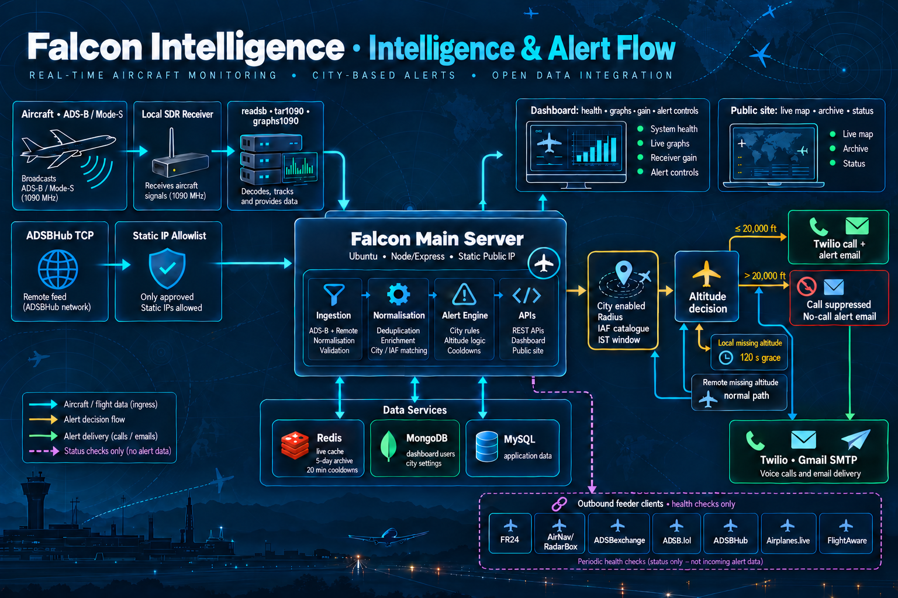

<p align="center">
  
</p>

# Falcon Intelligence

Falcon Intelligence is a self-hosted, Express-based aviation-intelligence platform that ingests local `readsb`/SDR JSON and approved ADS-B / Mode-S partner feeds, including ADSBHub TCP, to create a clear operational picture of the sky. It combines real-time aircraft maps, airspace-aware city tracking with email and VoIP Call escalation, a Redis-backed searchable observation archive and ICAO/Mode-S aircraft lookup, public exploration and status pages, and a MongoDB/JWT-protected operations dashboard for receiver health, feeder connections, historical graphs, gain control, alert recipients, and server monitoring—giving aviation teams and enthusiasts one practical place to receive, investigate, and act on aircraft activity.

## What it does

The project is designed to collect aircraft observations from a local `readsb`/SDR feed and partner feeds, then make the information useful without requiring a commercial tracking dashboard. Its public-facing pages include:



- A live aircraft map with selectable sources and map-bound filtering.
- An Intelligence Archive that retains aircraft observations in Redis for five days, with searching, filters, raw payload detail, and a last-known-position map.
- An aircraft detail lookup that resolves a valid ICAO / Mode-S hex code through the public HexDB registry.
- Explore, alert-status, authentication, contact, registration, and community pages.
- Alerts that can send email and place phone calls when configured aircraft enter defined airspaces.

## Architecture

```text
Browser (static HTML, CSS, vanilla JavaScript)
                 |
                 v
         Express 5 application
          |       |        |        |
          |       |        |        +--> Public aircraft registry lookup (HexDB)
          |       |        +-----------> MongoDB (dashboard account and profile data)
          |       +--------------------> MySQL (existing account and application data)
          +----------------------------> Redis (archive cache, application cache, and login limits)
                 ^
                 |
    Local readsb/SDR feed and ADSBHub TCP feed
```

The server serves the pages and JSON endpoints from the same origin. The frontend does not require a separate build tool or framework.

## Project layout

| Path | Purpose |
| --- | --- |
| `src/server.js` | Express application bootstrap, middleware, static files, route registration, and Socket.IO setup. |
| `public/` | Browser pages, stylesheets, client-side JavaScript, image assets, and sample archive data. |
| `routes/` | Feature routes for ADS-B data, archive records, authentication, alerts, communities, admin, APIs, and pages. |
| `services/` | Feed readers, SDR utilities, email delivery, signal analysis, and background service helpers. |
| `feedPartners/` | ADSBHub TCP connection and live-feed state. |
| `redis/` | Redis clients and the five-day tracked-aircraft archive cache. |
| `db/` | MySQL and MongoDB connection setup. |
| `models/` | MongoDB/Mongoose models, including the dashboard user profile. |
| `middlewares/` | Authentication, rate limiting, security, request filtering, and error handling. |
| `templates/` | HTML email templates. |
| `test/` | Documentation and scripts for the separate Kundali public-profile research utility. |

## Getting started

### Prerequisites

- Node.js 18 or later
- npm
- MySQL, for account and application data
- Redis, for application cache and tracked-aircraft archive data
- An ADS-B data source, such as a local `readsb` instance, for live ingestion

### Install and run

```bash
npm install
node src/server.js
```

The server listens on `PORT`, defaulting to `3001`. Open `http://localhost:3001` after startup.

### Configuration

Create a `.env` file in the project root. Start with the values required by the services you plan to use:

```dotenv
PORT=3001
NODE_ENV=development

MYSQL_HOST=127.0.0.1
MYSQL_USER=falcon
MYSQL_PASSWORD=change-me
MYSQL_DATABASE=falcon_intelligence

REDIS_HOST=127.0.0.1
REDIS_PORT=6379

# MongoDB is used alongside the existing MySQL database for dashboard users.
MONGO_URI=mongodb://127.0.0.1:27017/falcon_intelligence

# Optional dedicated Redis database for archive records. Defaults to database 1.
TRACKED_AIRCRAFTS_REDIS_DB=1

# Local readsb source. The server prefers the file when it exists.
READSB_AIRCRAFT_JSON_PATH=/run/readsb/aircraft.json
ADSB_FLIGHT_JSON_URL=http://127.0.0.1/data/aircraft.json
```

The following integrations are optional and only needed for their corresponding features:

| Feature | Relevant environment variables |
| --- | --- |
| JWT authentication | `JWT_SECRET` (or `JWT_SECRET_KEY`), `JWT_EXPIRES_IN`, `JWT_ISSUER`, `JWT_AUDIENCE`, `CLIENT_URL` |
| MongoDB dashboard and profile data | `MONGO_URI` |
| Resend email delivery for non-flight-alert legacy mail | `RESEND_API_KEY`, `EMAIL_FROM` |
| Gmail SMTP mail delivery for every flight alert | `GMAIL_SMTP`, `GMAIL_SMTP_PASSWORD` |
| Twilio calls | `TWILIO_ACCOUNT_SID`, `TWILIO_AUTH_TOKEN`, `TWILIO_CALLER_ID`, `TWILIO_CALL_TIMEOUT_SECONDS`; city call recipients use `BANGALORE_ALERT_PHONE_1`–`_4` and `DELHI_ALERT_PHONE_1`–`_4` (with optional `BANGALORE_AIRSPACE_NUMBER` and `DELHI_AIRSPACE_NUMBER` caller IDs) |
| Razorpay payments | `RAZORPAY_KEY_ID`, `RAZORPAY_KEY_SECRET` |
| ADSBHub live feed | `ADSBHUB_HOST`, `ADSBHUB_PORT`, `ADSBHUB_NO_DATA_WARNING_MS` |
| ADSB.lol re-api dashboard probe | `ADSBLOL_RE_API_URL`, `ADSBLOL_RE_API_CIRCLE`, `ADSBLOL_RE_API_TIMEOUT_MS` |
| Local ADS-B receiver dashboard | `READSB_STATS_JSON_PATH`, `READSB_RECEIVER_JSON_PATH`, `READSB_STATS_URL`, `READSB_RECEIVER_URL`, `READSB_LOG_PATH`, `READSB_LOG_LINES`, `READSB_HEALTHY_MESSAGE_RATE`, `READSB_MAX_BAD_MESSAGE_RATE`, `READSB_FRESH_MESSAGE_SECONDS` |
| Dashboard receiver-gain control | `READSB_GAIN_CONTROL_COMMAND` (defaults to `/usr/local/sbin/falcon-set-readsb-gain`) |
| Graphs1090 dashboard graphs | `GRAPHS1090_OUTPUT_DIR` (defaults to `/run/graphs1090`) and `GRAPHS1090_PERIOD` (defaults to `24h`) |
| Ubuntu feeder dashboard checks | `FEEDER_COMMAND_TIMEOUT_MS` |
| Dashboard server label | `DASHBOARD_SERVER_NAME` (defaults to `Main server`) |
| Mongo login protection | Redis-backed: 10 attempts per 1 hour for each email/username and IP pair |
| Anonymous visitor logs | Redis-backed: `VISITOR_LOG_MAX_RECORDS` (default `10000`), `VISITOR_LOG_MAX_PAGES` (default `50`), and `VISITOR_LOG_DASHBOARD_LIMIT` (default `100`) |
| Reverse-proxy client IPs | `TRUST_PROXY_HOPS=1` only when the app is exclusively behind one trusted proxy such as nginx |
| IP lookup | `IPINFO_API_KEY` |

Do not commit `.env` files or API credentials.

### Receiver software: readsb, tar1090, and graphs1090

For the local-SDR/Vadodara path, **readsb** is the receiver/decoder and is the only one of these three tools that is normally required. It writes the local aircraft and receiver JSON files that Falcon reads. **tar1090** is an optional web interface for that decoder, and **graphs1090** is an optional historical-graphs service. They are useful operationally, but neither replaces the Falcon dashboard or enables remote-city alerts.

These upstream installers target Debian-family receiver hosts (such as Ubuntu, Debian, or Raspberry Pi OS) and require an RTL-SDR-compatible receiver for local radio reception. Review every downloaded script before running it, run this on the receiver host rather than the public web server, and retain the upstream links below for current options and troubleshooting.

| Software | When it is needed | Falcon integration |
| --- | --- | --- |
| [readsb](https://github.com/wiedehopf/adsb-scripts) | Required for a local SDR receiver, including Vadodara tracking. | Falcon prefers `/run/readsb/aircraft.json`; it can also read `stats.json` and `receiver.json` for the protected dashboard. |
| [tar1090](https://github.com/wiedehopf/tar1090) | Recommended for an on-host/lab web map and raw JSON diagnostics. | Serves readsb data at `/tar1090/data/…`; set `ADSB_FLIGHT_JSON_URL` only if Falcon needs to use that HTTP source instead of the local file. |
| [graphs1090](https://github.com/wiedehopf/graphs1090) | Optional; use when historical receiver/range/message-rate graphs are useful. | Point `GRAPHS1090_OUTPUT_DIR` at its generated graph directory; the dashboard defaults to `/run/graphs1090`. |

Install the base utilities once:

```bash
sudo apt update
sudo apt install -y curl wget
```

#### Install readsb

The maintained readsb installer also installs tar1090 unless instructed otherwise. Use the upstream script only after inspecting it:

```bash
curl -fsSL https://github.com/wiedehopf/adsb-scripts/raw/master/readsb-install.sh -o /tmp/readsb-install.sh
less /tmp/readsb-install.sh
sudo bash /tmp/readsb-install.sh

# Set the physical receiver location after installation.
sudo readsb-set-location <latitude> <longitude>
sudo systemctl status readsb --no-pager
```

After readsb is working, keep Falcon on the local file path where possible:

```dotenv
READSB_AIRCRAFT_JSON_PATH=/run/readsb/aircraft.json
```

#### Install or verify tar1090

Skip this step when the readsb installer has already installed tar1090. Otherwise, install it with its maintained installer:

```bash
sudo bash -c "$(wget -nv -O - https://github.com/wiedehopf/tar1090/raw/master/install.sh)"
sudo systemctl status tar1090 --no-pager
```

Open `http://<receiver-host>/tar1090/` from a trusted network. Its useful local diagnostic endpoints include:

```text
http://<receiver-host>/tar1090/data/aircraft.json
http://<receiver-host>/tar1090/data/stats.json
http://<receiver-host>/tar1090/data/status.json
http://<receiver-host>/tar1090/data/outline.json
http://<receiver-host>/tar1090/data/stats.prom
http://<receiver-host>/tar1090/data/status.prom
```

If the Falcon service cannot read `/run/readsb/aircraft.json` directly, it may use tar1090 instead:

```dotenv
ADSB_FLIGHT_JSON_URL=http://127.0.0.1/tar1090/data/aircraft.json
```

Do not expose these raw receiver endpoints to the public internet without authentication, a VPN, or an appropriately restricted reverse proxy.

#### Install graphs1090

Install graphs1090 only after readsb is producing `stats.json`:

```bash
sudo bash -c "$(curl -L -o - https://github.com/wiedehopf/graphs1090/raw/master/install.sh)"
sudo systemctl status graphs1090 --no-pager
```

Its configuration is normally in `/etc/default/graphs1090`. Configure Falcon with the directory that contains the generated graph images, then restart the Falcon Node service:

```dotenv
GRAPHS1090_OUTPUT_DIR=/run/graphs1090
GRAPHS1090_PERIOD=24h
```

### Data-sharing receiver status and endpoints

Falcon exposes **local process health**, not a proxy for each partner's private feeder dashboard. The Mongo/JWT-protected `GET /api/dashboard/stats` endpoint (and **Dashboard → Feed clients**) reports whether the local feeder service/process is present for Flightradar24, AirNav Radar, ADSBexchange, ADSB.lol, ADSBHub, Airplanes.live, and FlightAware. A healthy local process does **not** prove that the remote provider accepted its upload; confirm that in the provider location below.

| Data-sharing network | Receiver-detail/status location | Notes |
| --- | --- | --- |
| Flightradar24 | Sign in to the [Flightradar24 account data-sharing area](https://www.flightradar24.com/account/data-sharing) and open the receiver's feed statistics. | Feed-owner access; there is no Falcon-created public receiver-details endpoint. |
| AirNav Radar | `https://www.airnavradar.com/stations/<station-id>` | Replace `<station-id>` with the station identifier shown in AirNav/RadarBox; this page shows the station's live/range/uptime information. |
| ADSBexchange | [ADSBexchange feeder hub](https://www.adsbexchange.com/community/feeder-hub/connect-equipment/) and [My IP](https://www.adsbexchange.com/myip/) from the receiver network. | Use the hub/account to confirm feeder acceptance; `myip` helps identify the egress address used by the receiver. |
| ADSB.lol | [ADSB.lol](https://www.adsb.lol/) feeder/account view; if its optional local UI is installed, `http://<receiver-host>/adsblol`. | The local path exists only when the ADSB.lol client interface has been installed. |
| ADSBHub | Sign in and open the account [Statistics](https://data.adsbhub.org/howtofeed.php) page. | Provider-side receiver statistics are account-bound rather than a public Falcon endpoint. |
| Airplanes.live | [Airplanes.live API documentation](https://airplanes.live/api-docs/), including its feeder-status operation. | Follow that documentation's current authentication and feeder-identifier requirements; Falcon does not store or proxy its API credentials. |
| FlightAware | Sign in to the PiAware feeder's statistics page; global [PiAware site statistics](https://www.flightaware.com/adsb/stats/sites) are also available. | Detailed per-receiver statistics are restricted to the feeder owner/provider staff. |

When sharing one receiver with more than one network, use credentials issued for that receiver and review every provider's sharing policy before enabling another client. In particular, a Flightradar24-supplied receiver is subject to a no-third-party-feeding condition in its [receiver agreement](https://www.flightradar24.com/files/Our_Receiver.pdf). Never put feeder keys, account cookies, or provider API tokens in this repository or in client-side JavaScript.

### Remote city call and email alerts

Remote city alerts use the ADSBHub TCP feed and are controlled from **Dashboard → Flight alerts**. A city must be enabled there before the service reads its nearby-aircraft feed, records a match, sends an email, or starts a call. Vadodara is intentionally separate: it remains on the local SDR/readsb path and is not governed by the remote-city controls.

| City | Default tracking state | Alert source | Call-recipient environment variables | Email delivery |
| --- | --- | --- | --- | --- |
| Bangalore | Disabled | ADSBHub TCP | `BANGALORE_ALERT_PHONE_1` through `_4`; optional `BANGALORE_AIRSPACE_NUMBER` caller ID | Gmail SMTP |
| Delhi | Disabled | ADSBHub TCP | `DELHI_ALERT_PHONE_1` through `_4`; optional `DELHI_AIRSPACE_NUMBER` caller ID | Gmail SMTP |
| Hyderabad | Enabled | ADSBHub TCP | `LOKESH_BHAI_PHONE`; optional `HYDERABAD_AIRSPACE_NUMBER` caller ID | Gmail SMTP |
| Vadodara | Local SDR path | Local readsb/SDR | Existing local-alert configuration | Gmail SMTP |

To activate Delhi call and email alerts:

1. Configure Gmail SMTP (`GMAIL_SMTP` and `GMAIL_SMTP_PASSWORD`) and Twilio (`TWILIO_ACCOUNT_SID`, `TWILIO_AUTH_TOKEN`, and `TWILIO_CALLER_ID`).
2. Add one or more E.164 phone numbers to the server environment, for example:

   ```dotenv
   DELHI_ALERT_PHONE_1=+919999999999
   # Optional: use a Delhi-specific Twilio sender instead of TWILIO_CALLER_ID.
   DELHI_AIRSPACE_NUMBER=+12296653927
   ```

3. Restart the Node service so it reads the new phone-number configuration.
4. Sign in, open **Dashboard → Flight alerts**, add the Delhi email recipients, choose a Delhi radius, enable **Delhi tracking and alerts**, then save each setting.

No calls are made unless the city is enabled and at least one city phone variable is configured. The normal altitude rules still apply: an aircraft above 20,000 ft receives a no-call email instead of a call where that city is configured for high-altitude suppression. No-call email subjects use `Falcon Intelligence [City] | No Call Alert | …`, and the city is named in the email header and body.

### Adding a remote city for call and email alerts

Adding a remote city is a code change because the app keeps an explicit allow-list of airspaces. Use this checklist for a city such as `examplecity`:

1. Add `iafDataExamplecity.js`, exporting an `allAircraft` catalog with the aircraft `HexCode`, `Registration`, `AircraftType`, `TypeCode`, and `AircraftOperator` fields.
2. Add `examplecity` to `CONFIGURABLE_CITY_IDS`, `DEFAULT_CITY_ALERT_ENABLED`, and `DEFAULT_CITY_ALERT_EMAIL_RECIPIENTS` in `utils/cityAlertDefaults.js`; add matching `radii`, `enabled`, and `emailRecipients` paths to `models/CityAlertSettings.js`.
3. In `routes/apiRoutes.js`, import the catalog, define the city centre, add its `EXAMPLECITY_ALERT_PHONE_1`–`_4` array and optional `EXAMPLECITY_AIRSPACE_NUMBER`, then add a `cityAlertConfigs` entry. Set its label, radius, email recipients, enabled state, call configuration, cache preference, data catalog, and distance-field name.
4. Extend the protected dashboard API in `routes/privateStatsRoutes.js` with the city call-number labels. Add a dashboard switch, radius input, recipient card, and recipient selector option in `public/dashboard.html` and `public/dashboard.js`.
5. If the city needs a public status or archive view, add its status endpoint/view and register it in the tracked-aircraft selector. Add it to the server-health response and this README as appropriate.
6. Add the new phone variables to the deployment environment, restart the service, configure recipients and radius in the dashboard, enable the city, and verify an alert with a controlled feed record.

Keep local-SDR cities separate from this list unless they should deliberately move to the ADSBHub remote-alert pipeline.

### Understanding and changing local-SDR gain

**Gain is the amount of amplification applied by the radio tuner before `readsb` decodes 1090 MHz ADS-B / Mode-S signals.** It is an RF-receiver setting for the local SDR path—currently the Vadodara receiver—not an aircraft altitude, map, cache, alert, or remote-city setting. Changing it does not affect the ADSBHub-backed Bangalore, Delhi, or Hyderabad feeds, their dashboard switches, or their email/call rules.

More gain can make a weak, distant aircraft signal large enough to decode. It also amplifies unwanted RF energy: electrical noise, strong nearby transmitters, and interference. At a point the tuner or ADC can overload (desensitise), which can mean *fewer* useful ADS-B messages even though the configured number is higher. The best setting is therefore **the lowest gain that produces the best stable valid-message and range results for this antenna and RF environment**, not automatically the maximum dB value.

`auto` is the recommended initial setting. In automatic mode, readsb's ADS-B-oriented algorithm adjusts the RTL-SDR tuner gain in response to its observed noise and strong signals. Use manual gain only when you have a reason to compare repeatable settings—for example after moving the antenna, adding a 1090 MHz filter/LNA, or diagnosing local RF interference.

#### Finding the optimal gain

There is no universal "optimal gain": antenna height, coax loss, an inline filter/LNA, receiver hardware, nearby cellular/broadcast transmitters, and local electrical noise all matter. Tune it empirically while keeping the physical installation unchanged.

1. Start with **Automatic** and let the receiver run through normal traffic for at least 15–30 minutes. Use a longer, comparable period where possible; traffic volume itself varies through the day.
2. Record the Dashboard receiver figures—received-message rate, bad-message rate, current aircraft count, last aircraft update—and the range/message graphs from graphs1090 if installed.
3. If testing manual gain, begin in the middle of the tuner range (for a typical RTL-SDR, `38.6 dB` or `40.2 dB` is a sensible comparison point). Test one supported step at a time, usually moving by roughly 2–4 dB, and observe each setting for the same period.
4. Keep the setting that improves sustained valid-message rate and useful range **without** a meaningful rise in bad messages or gaps in nearby/strong aircraft. If increasing gain stops helping—or message quality/range worsens—step back to the previous setting.
5. Recheck after antenna, cable, filter, LNA, or receiver changes. A new installation should return to `auto` until it has a fresh baseline.

Typical symptoms are: too little gain gives weak-signal loss and lower range; too much gain can give an elevated bad-message rate, bursts of noise, or poorer decoding despite strong local traffic. An external 1090 MHz filter often improves a noisy site more than turning the gain up. Do not use the dashboard to compensate for a bad antenna location, damaged coax, or receiver power/USB noise.

The Dashboard accepts `auto` or a manual value from `0` to `59.6 dB`, in 0.1 dB input increments. That is Falcon's safe input boundary, **not a promise that every SDR exposes every value**. `readsb` applies values supported by the connected tuner; common RTL-SDR/R820T-class devices use discrete steps such as `36.4`, `37.2`, `38.6`, `40.2`, `42.1`, `43.4`, `43.9`, `44.5`, `48.0`, and `49.6 dB` (with hardware/build-dependent alternatives). Check `readsb --help` on the receiver for its authoritative list. If a selected value prevents readsb from restarting, the helper restores the prior configuration.

#### What the dashboard changes

When an authenticated dashboard user submits the control, Falcon validates the requested mode/value, invokes one narrowly permitted root helper, updates only the `--gain` entry inside `RECEIVER_OPTIONS` in `/etc/default/readsb`, and restarts `readsb`. Expect a short interruption to the local receiver JSON/map while it restarts. The helper creates `/etc/default/readsb.falcon-gain-backup`; if the restart fails, it restores that previous configuration and attempts to restart readsb with it. The dashboard then reads the live receiver statistics again, including the gain reported by readsb when available.

This requires a root-owned, restricted helper; the Node process deliberately does not receive broad sudo access. On the receiver server, install the helper and allow only that exact command for the account that runs the Falcon Node service:

```bash
sudo install -o root -g root -m 0750 scripts/falcon-set-readsb-gain /usr/local/sbin/falcon-set-readsb-gain
sudo visudo -f /etc/sudoers.d/falcon-readsb-gain
```

Add this sudoers entry, replacing `<app-user>` with the account used by the Node service:

```text
<app-user> ALL=(root) NOPASSWD: /usr/local/sbin/falcon-set-readsb-gain
```

Validate it with `sudo visudo -cf /etc/sudoers.d/falcon-readsb-gain`. The helper only accepts `auto` or a gain in the allowed range, updates `RECEIVER_OPTIONS` in `/etc/default/readsb`, creates `/etc/default/readsb.falcon-gain-backup`, and restores the previous setting if `readsb` fails to restart.

## Key pages and endpoints

| Path | Description |
| --- | --- |
| `/` | Falcon Intelligence landing page. |
| `/live-map` | Live-map page. |
| `/live-map/aircrafts` | Current map aircraft feed. Supports source, bounding-box, and limit options. |
| `/tracked-aircrafts` | Intelligence Archive page. |
| `/trackedaircrafts` | Archived aircraft JSON; returns labelled sample data only when the archive is empty or unavailable. |
| `/aircraft-lookup/:hex` | Validated six-character ICAO / Mode-S registry lookup used by the archive popup. |
| `/explore` | Aircraft exploration page. |
| `/bangalore-status`, `/delhi-status`, and `/hyderabad-status` | City alert-status pages; disabled cities do not request their nearby-aircraft feed. |
| `/api/aircraft/nearby` | Nearby-aircraft API; additional compatible ADSBHub TCP paths are available under `/api/adsbhub-tcp`. |
| `/auth/mongo/login` | MongoDB/JWT login for the protected dashboard and profile. This is separate from the existing MySQL `/auth` flow. |
| `/dashboard` | Mongo-JWT-protected operations dashboard. Direct `/dashboard.html` access is also protected before static files are served. |
| `/api/dashboard/stats` | Mongo-JWT-protected main-server station, feed, server-health, and configured alert-recipient data. |
| `/api/dashboard/city-alert-enabled` | Mongo-JWT-protected `PUT` endpoint for the per-city remote tracking and alert switches. |
| `/api/dashboard/city-alert-radii` and `/api/dashboard/city-alert-email-recipients` | Mongo-JWT-protected city radius and email-recipient management endpoints. |
| `/profile` | Mongo-JWT-protected profile page, including profile-photo updates. |
| `/falcon-video-generator` | Video-generator page; its upload and generation APIs require Mongo/JWT login. |

Authentication, admin, community, alert, payment, and AI endpoints live under their route prefixes (`/auth`, `/admin`, `/adsb`, `/ai`, and `/api`). Read the matching module in `routes/` before integrating with them, as many require authentication or an external credential.

## Recent authentication and dashboard changes

The existing MySQL authentication system is retained under `/auth`. MongoDB/JWT authentication was added in parallel under `/auth/mongo` so the newer dashboard features do not replace existing MySQL users or routes.

- Mongo accounts use bcrypt password hashes, and the JWT middleware validates the expected algorithm, issuer, audience, expiry, and user record.
- A successful Mongo login sets the separate `mongoToken` cookie. It persists for 30 days by default (configurable with `AUTH_SESSION_COOKIE_MAX_AGE_MS`) so mobile browsers do not discard it as a session cookie; set `JWT_EXPIRES_IN` to the same duration. It is currently configured as browser-readable (`httpOnly: false`) to support the requested client-side token access; this is less resistant to XSS than an HttpOnly cookie.
- Mongo login attempts are Redis-limited to 10 per one-hour window for each normalized email/username and IP pair. Keys use a SHA-256 fingerprint instead of storing the raw email or IP. If Redis is unavailable, login fails closed with HTTP 503 rather than allowing unlimited attempts.
- `/dashboard`, `/dashboard.html`, `/api/dashboard/stats`, and `/api/private-stats` require a valid Mongo JWT. Dashboard data is collected by the Node/Ubuntu host, not the visitor's device.
- Browser navigation to a protected page redirects to `/login` when the Mongo JWT is missing or invalid. Protected API requests continue to return JSON `401` responses for client-side handling.
- The dashboard shows the authenticated greeting, configured station status, ADSBHub TCP and ADSB.lol re-api receiving data, local Ubuntu feeder checks, alert phone numbers currently configured in the server environment, and a main-server identity label.
- The Dashboard **Flight alerts** tab independently enables Bangalore, Delhi, and Hyderabad remote-airspace tracking. Disabled cities do not query their ADSBHub nearby-aircraft endpoint, cache matches, or issue email/call alerts. New and legacy settings default to Hyderabad enabled and Bangalore/Delhi disabled; Vadodara remains outside this control because it uses the local SDR feed. Delhi uses the same remote email-and-call pipeline as Bangalore, with `DELHI_ALERT_PHONE_1`–`_4` as its configurable call recipients.
- High-altitude no-call emails are city-aware in both delivery paths: their subject is `Falcon Intelligence [City] | No Call Alert | …`, and their header and body state the monitored city.
- Main-server health reporting includes Ubuntu OS details, RAM used/available, CPU load, root-disk usage, MongoDB and Redis connection status (each with a bounded ping), system uptime, and Node process RSS memory. RAM uses `/proc/meminfo`; disk reporting uses filesystem metrics with an Ubuntu `df` fallback.
- The protected Dashboard **Visitor logs** tab shows anonymous public-page visitors grouped by IP address, along with parsed browser, device, operating-system, and unique page-path data. Logged-in sessions, API calls, assets, and protected routes are excluded.
- Visitor logs use bounded Redis storage: one hash and one unique-page set per IP address, a 24-hour TTL starting with the first recorded visit, a 10,000-record default cap, and a 50-page-per-visitor default cap. Repeated requests to the same page do not add records or pages. The Dashboard switch pauses/resumes future collection; existing records still age out within 24 hours.
- When deployed behind nginx or another reverse proxy, set `TRUST_PROXY_HOPS=1` only if the Node server is not directly public; this lets Express safely use the proxy-provided client IP for visitor grouping and rate limiting.
- The profile page allows a signed-in user to replace their JPEG, PNG, or WebP profile photo. Uploads are limited to 5 MB, checked against file signatures, stored with generated names, and old managed photos are removed after a successful replacement.
- The video generator no longer accepts a separate password. Its upload, delete, and generation APIs require Mongo/JWT login.
- Shared navigation is applied across the public pages. Logged-in users see a simple profile icon with **My Profile**, **Dashboard**, and **Logout**; Dashboard is intentionally not a primary navigation link.

### Related implementation files

| Area | Main files |
| --- | --- |
| Mongo/JWT auth | `controllers/authController.js`, `routes/authRoutes.js`, `middlewares/mongodbAuthMiddleware.js` |
| Redis Mongo login limiter | `middlewares/mongoLoginRateLimiter.js` |
| Dashboard and server metrics | `routes/privateStatsRoutes.js`, `public/dashboard.html`, `public/dashboard.js`, `public/dashboard.css` |
| Profile and photo upload | `public/profile.html`, `public/profile.js`, `public/profile.css` |
| Shared signed-in navigation | `public/nav-auth.js`, `public/shared-nav.css` |

## Technical details

### Data flow

1. The local SDR feed reader loads `aircraft.json`, preferring `READSB_AIRCRAFT_JSON_PATH` and falling back to `ADSB_FLIGHT_JSON_URL`.
2. Feed records are normalized and stored in Redis under `tracked-aircraft:*` keys.
3. Archive entries expire after five days. Newer partial feed messages preserve previously known aircraft fields where possible.
4. The archive page requests `/trackedaircrafts`, then handles filtering, sorting, grouping, and detail rendering in the browser.
5. A user can select **Predict Aircraft** in a detail popup to look up a valid six-character hex code. The server validates the input, calls HexDB with a five-second timeout, and caches successful responses for six hours.

### Flight-alert decision flow

Falcon has two independent alert engines. **Bangalore, Delhi, and Hyderabad** use the dashboard-controlled ADSBHub TCP airspace pipeline. **Vadodara** uses the local readsb/SDR pipeline in `routes/adsbRoutes.js`. Their source, matching, altitude, and delivery rules are intentionally different.

#### Remote city alerts: Bangalore, Delhi, and Hyderabad

1. At startup, each city starts a one-second polling timer. The first effective action is determined by its dashboard setting: Bangalore and Delhi default to disabled; Hyderabad defaults to enabled. Saved MongoDB settings update the active radius, enabled state, and email-recipient list without requiring a Node restart.
2. A **disabled** city returns before reading ADSBHub data. It does not inspect nearby aircraft, write matched-aircraft cache entries, or send email/call alerts. Its public nearby-aircraft request at that city's exact coordinates is also rejected as disabled.
3. An enabled city takes the current in-memory ADSBHub TCP snapshot, discards aircraft without a valid latitude/longitude, calculates great-circle distance from the configured city centre, keeps aircraft inside the configured radius, sorts nearest first, and considers at most 500 records. ADSBHub records are evicted after 60 seconds without a message (during a 10-second cleanup cycle), so a disconnected, empty, or stale feed produces no candidate alerts.
4. An aircraft must have a hexadecimal ICAO/Mode-S value in that city's IAF catalogue to be a match. Aircraft outside the radius, without a usable position, without a hex code, or absent from that city catalogue do not produce an alert.
5. Matching aircraft are recorded in a city-specific Redis key and exposed in that city's status/health response. The match cache is refreshed while the aircraft remains visible and expires 20 minutes after its last matching write.
6. Notification delivery is allowed only from **08:00 through 01:59 Asia/Kolkata time**. During the 02:00–07:59 quiet period, enabled cities still read, match, cache, and report aircraft, but they do not send emails or place calls.
7. During the notification window, Falcon evaluates email and call delivery independently for every configured recipient. Redis reserves a separate 20-minute cooldown per city, ICAO, alert type, and recipient/phone number before the external delivery request is made. A delivery failure is logged; it is not retried during that cooldown window.

| Remote-city condition | Match/cache result | Email result | Call result |
| --- | --- | --- | --- |
| City disabled | No ADSBHub read, no match cache. | None. | None. |
| City enabled, but aircraft is outside the radius or not in its IAF catalogue | No alert match. | None. | None. |
| City enabled and matching, but outside the IST notification window | Match is cached and shown in status. | None. | None. |
| Matching, active window, on ground / altitude missing / numeric altitude at or below 20,000 ft | Match is cached. | Normal city alert email. | Twilio call to each configured city phone after its cooldown. |
| Any remote-city match above 20,000 ft | Match is cached. | `Falcon Intelligence [City] | No Call Alert | …` email, with the matching city named in the HTML content. | Suppressed. |

Remote cities do **not** wait for a missing altitude. A missing/non-numeric altitude is call-permitted and follows the normal-email path. For every remote city, an aircraft above 20,000 ft suppresses the call and uses the city-named no-call email path. Every flight-alert email is delivered through Gmail SMTP. Calls require the appropriate city phone variables to be configured; with no valid phone numbers, the call stage exits without creating a Twilio call.

#### Local SDR alerts: Vadodara

1. The local loop polls every two seconds by default (`ADSB_TRACKING_INTERVAL_MS`). It reads `READSB_AIRCRAFT_JSON_PATH` first and falls back to `ADSB_FLIGHT_JSON_URL` only when the file cannot be read. If neither source can be read, the polling error is logged and that iteration sends no local alerts.
2. Each feed record with a usable hex code is offered to the five-day tracked-aircraft archive before IAF matching is evaluated. The legacy local alert match is by catalogue ICAO/Mode-S hex code. Unlike the remote-city pipeline, it does **not** calculate or enforce a Vadodara radius; location is retained as aircraft telemetry only.
3. A catalogue match receives identity fallbacks from `iafData.js` when the live feed omits registration, type, description, or operator. Non-catalogue aircraft are archived but do not enter the local notification flow.
4. The altitude branch is then evaluated as follows:

| Local/Vadodara altitude state | Decision |
| --- | --- |
| `alt_baro` is `ground` | Any pending altitude grace state is cancelled. The aircraft is call-permitted and follows the normal-email path. |
| A valid numeric altitude is present | It is saved in Redis for 60 seconds and any pending grace state is cancelled. At or below 20,000 ft is call-permitted; above 20,000 ft suppresses the call and selects the no-call email path. |
| Altitude is missing, but a valid value was cached in the preceding 60 seconds | The cached altitude is used for the same at-or-below/above-20,000-ft decision. |
| Altitude is missing and no recent altitude is cached | Falcon starts a one-time 120-second grace period. Until it expires, it sends neither the normal call nor email. |
| Still missing after the 120-second grace period | Missing altitude is treated as not high altitude, so the normal call and normal-email decisions proceed. |
| Aircraft disappears while its altitude grace period is still pending | The grace timer is cancelled and Falcon triggers the call path immediately. This disappearance path does not itself run the normal-email loop. |

5. Local calls, normal emails, and no-call emails each use their own Redis cooldown key: one key per ICAO and phone/email recipient, valid for 20 minutes. Therefore a call recipient may be suppressed while another recipient is still eligible, and a normal email cooldown is separate from a no-call email cooldown.
6. For a normal local match, the call path runs first and then the normal-email path. For a high-altitude match, the call is skipped and the no-call email path is used; its title is `Falcon Intelligence [Vadodara] | No Call Alert | …` and the template names Vadodara in the content. Every local flight-alert email is sent through Gmail SMTP; a failure is logged. As with remote alerts, the cooldown is acquired before delivery, so a failed attempt is not automatically retried until it expires.

In both engines, a Twilio API failure, mail-provider failure, unavailable Redis operation, missing delivery credentials, no configured recipient, or missing live source data prevents that particular delivery. Check the server log together with the city status/dashboard view when diagnosing a non-delivery; a receiver or feeder process being healthy alone does not prove that an alert was eligible or sent.

### Stack

- **Runtime:** Node.js with CommonJS modules
- **HTTP:** Express 5, `axios`, `compression`, `cors`, `helmet`, `hpp`, and Socket.IO
- **Frontend:** static HTML, CSS, and browser JavaScript; Leaflet is vendored under `public/vendor/leaflet`
- **Data stores:** MySQL via `mysql2` and Redis via `ioredis`
- **Security controls:** JWT middleware, bcrypt password hashing, XSS cleaning, request rate limits, SQL-injection guarding, brute-force protection, and Helmet headers
- **Notifications and payments:** Nodemailer/Gmail SMTP for flight alerts, Resend for legacy non-alert mail, Twilio, and Razorpay when configured

### Development notes

- `npm run osint:profiles` runs the separate Kundali profile-research utility. Its full usage and responsible-use guidance are in [test/README.md](test/README.md).
- The current `npm test` script is a placeholder; a repository-wide automated test suite has not been configured yet.
- The app uses a general rate limiter. Account and external-service routes may apply additional limits.
- The archive's HexDB data is supplementary registry information, not an authoritative flight record. It can be incomplete or out of date.

### Development-only alert tests with the dummy feed

`public/dummyAircraftData.json` is a readsb-shaped **test input** for the legacy local/Vadodara tracking path. It is not an archive fallback and it does not exercise the Bangalore, Delhi, or Hyderabad remote-city pipeline; those cities receive their data from ADSBHub TCP and must be enabled in the dashboard before their alerts can run.

The sample includes ICAO `800E42` (KC3813), which is present in the local IAF catalogue and has an altitude of `2000` ft. It therefore exercises the normal matched-aircraft branch: archive write, low-altitude call decision, and normal-email decision. The tracking loop polls every two seconds by default (`ADSB_TRACKING_INTERVAL_MS`) and Redis suppresses each call/email variant for 20 minutes, so one match will not repeatedly send the same notification during that window.

**Never run this flow with production delivery credentials or real recipient numbers.** A matching dummy record can invoke the real notification code. The current legacy Vadodara path also has its recipient list in `routes/adsbRoutes.js`, rather than in the dashboard. For a delivery test, use an isolated mail/Twilio test account and temporarily limit that local recipient list to one approved test mailbox in an uncommitted working copy.

1. Stop the normal development instance, or select an unused local port. Keep the production service and its `.env` untouched.
2. Create a private test environment file outside the repository and a disposable public test feed:

   ```bash
   cp .env /tmp/falcon-alert-test.env
   cp public/dummyAircraftData.json public/dummyAircraftData.alert-test.json
   ```

3. Edit `/tmp/falcon-alert-test.env` and set these values. `READSB_AIRCRAFT_JSON_PATH` deliberately points to a nonexistent test path: Falcon always attempts that local file first and only then uses the HTTP feed URL.

   ```dotenv
   PORT=3002
   READSB_AIRCRAFT_JSON_PATH=/tmp/falcon-readsb-disabled-for-alert-test.json
   ADSB_FLIGHT_JSON_URL=http://127.0.0.1:3002/dummyAircraftData.alert-test.json
   ADSB_TRACKING_INTERVAL_MS=2000
   ADSB_DEBUG_LOGS=true
   ```

   Do **not** change `BASE_URL` for this purpose. It is used for application-generated links, such as password-reset URLs; the aircraft feed is controlled by `ADSB_FLIGHT_JSON_URL`.

4. Start Falcon with that environment file:

   ```bash
   dotenv_config_path=/tmp/falcon-alert-test.env node -r dotenv/config src/server.js
   ```

5. Verify that the static dummy feed and the processing route are reachable. The archive response should acquire the test record after a poll completes:

   ```bash
   curl http://127.0.0.1:3002/dummyAircraftData.alert-test.json
   curl http://127.0.0.1:3002/adsb/aircrafts
   curl http://127.0.0.1:3002/trackedaircrafts
   ```

6. Test the branch required, always using a matching ICAO from `iafData.js` in the disposable file:

   | Scenario | Change in `public/dummyAircraftData.alert-test.json` | Expected local/Vadodara behavior |
   | --- | --- | --- |
   | Normal alert | Leave `800E42` at `alt_baro: 2000`. | The normal call and email decisions are reached; actual delivery depends on the deliberately isolated test credentials/recipients. |
   | High-altitude no-call | Change the matching record to `alt_baro: 20001` or higher. | No call is attempted; the no-call email path is selected with the Vadodara city name in the subject and body. |
   | Unknown-altitude grace period | Use an otherwise unused catalogue ICAO such as `800E23`, remove its `alt_baro`, and wait 120 seconds. | Falcon waits for the altitude grace period before allowing the normal-alert decision. |

   The feed is reread on each poll, so JSON edits take effect without restarting Falcon. Use a fresh matching ICAO or wait for the relevant Redis cooldown before repeating the same scenario.

7. Stop the test process, remove `public/dummyAircraftData.alert-test.json`, and restart the normal service with its original receiver settings. Do not use broad Redis flush commands to reset an alert test; its cache may contain unrelated application data.

## Contributing

Keep changes scoped to their feature area, avoid committing credentials or production data, and validate server-side and browser-side JavaScript before submitting changes. For user-facing archive work, test both live-cache and controlled dummy-feed states where applicable.

## License

This repository currently declares the `ISC` license in `package.json`.
